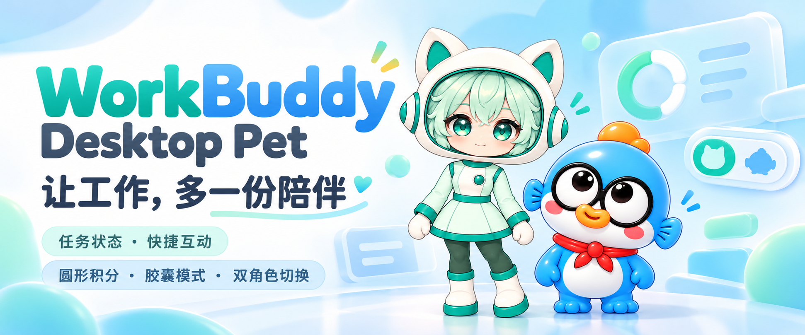
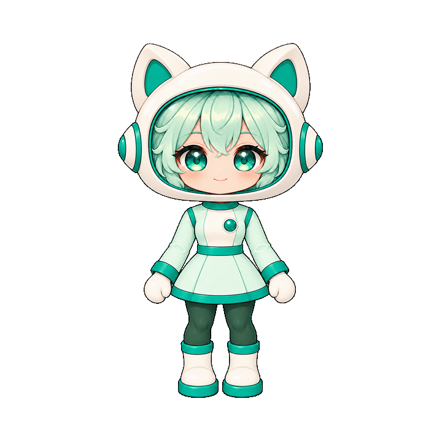

> 开发版本 v0.6.7（待发布）：修复“稍后”仍自动安装、过期状态与休闲动作不一致及工具乱序；优化素材校验、后台状态写入和日志增量统计。最近正式版仍为 v0.6.6，下载入口以正式发行页为准。见[待发布说明](docs/releases/v0.6.7.md)。

# WorkBuddy Desktop Pet · WorkBuddy 桌面搭子



让 WorkBuddy 的工作进度，变成桌面上看得见的陪伴。

为 **Windows 10 / 11 x64** 打造的 WorkBuddy 专用桌宠：任务进行时陪你工作，完成时提醒你，空闲时眨眼、招手、吃零食。通过会话胶囊查看任务、积分与本机用量，也可以一键回到 WorkBuddy 对话。

[下载 Windows 最新版](https://github.com/zhujiaowo-sudo/workbuddy-desktop-pet/releases/latest) · [安装与连接](#安装与首次连接) · [操作指南](#怎么使用) · [常见问题](#常见问题) · [自制角色](docs/materials.md)

<p align="center">
  
</p>
<p align="center"><strong>薄荷星伴 · 跟着任务工作，也会回应你的点击</strong></p>

## 动起来的桌面搭子

| 待机 · 自然眨眼 | 工作 · 坐姿使用电脑 | 休闲 · 玩手机 |
| :---: | :---: | :---: |
|  |  |  |

以上均直接引用程序内置的原始 GIF，展示角色动作，**不是 WorkBuddy 真实任务联动录屏**。默认套装为薄荷星伴 **2.0.0**，共 **16 段 720×720 透明 GIF**，包含待机、6种其他任务状态、4种点击互动、4种休闲动作和挠头。所有动作每段16帧，保留作者原始画面及时序；待机4.61秒，其他2.25–3.16秒。

### 新增套装：蓝色小鱼


v0.6.5新增蓝色小鱼1.0.0；v0.6.6更新为1.0.1，仅替换思考动画，其他15段保持不变。套装包含完整16组720×720透明GIF，包括吃酸菜鱼。素材页可在薄荷星伴与蓝色小鱼之间切换；更新保持当前角色选择。新套装由用户提供并授权本项目发布，原包未声明通用再分发许可，见[蓝色小鱼素材说明](licenses/blue-fish/NOTICE.txt)。

当前正式版为 **v0.6.6**，动画已随程序内置，无需另下素材包。见[版本说明](docs/releases/v0.6.6.md)与[全部发行版本](https://github.com/zhujiaowo-sudo/workbuddy-desktop-pet/releases)。

## 功能特性

| 能力 | 你可以做什么 |
| --- | --- |
| 任务状态陪伴 | 展示空闲、思考、执行工具、等待回复、等待确认、完成和失败；汇总多个会话，优先提示需要处理的任务。 |
| 点击与闲置互动 | 左键轮换招手、比心、害羞、惊讶；空闲时随机吃零食、玩手机、伸懒腰、听音乐，偶尔挠头。重要任务提示优先。 |
| 胶囊与数据小卡 | 点击会话胶囊查看小卡，再展开任务详情、积分与模型统计、素材和设置；支持拖动、位置记忆与闲置缩卡。 |
| 积分与模型统计 | 分别显示经授权查询的账户剩余积分、本机今日消耗，以及全部／7天／30天的本机模型使用记录。 |
| 手动签到 | 独立授权后点击签到按钮领取；后台只查询状态，不自动领取，已签到不重复提交。 |
| 会话直达 | 点击会话名称或聊天入口打开对应 WorkBuddy 对话；没有当前会话时打开主程序。 |
| 仅卡片模式 | 隐藏角色并停止动画解码，保留任务、统计和设置；也可临时收成可独立拖动的胶囊。 |
| 自制角色 | 导入 ZIP 或文件夹、按动作预览、启用、删除；支持 PNG/APNG、GIF、WebP，可导出内置完整套装副本。 |
| 更新与连接管理 | 首次连接引导、接入诊断、可选登录自启；正式发布版支持检查更新、校验下载、安装重启与失败回退。 |

**接入范围：** 已在 WorkBuddy 5.9.2 验证主要任务开始、工具调用与完成事件；本轮在5.9.3再次观察到这些事件，并确认真实审批通知及现有桌宠的待确认状态。等待输入、独立失败和子任务事件仍未完成真实验收，完成后的idle_prompt不作为等待输入证据。播放器及状态逻辑支持这些状态，不能据此认定所有版本都会发出对应事件。详见[兼容性记录](docs/compatibility.md)。

## 运行环境

| 项目 | 要求 |
| --- | --- |
| 操作系统 | Windows 10 / 11，x64；已验证 Windows 10 22H2，较旧版本需另测。当前不提供 macOS、Linux 或 ARM64 安装包。 |
| WorkBuddy | 实际任务联动需在同一台电脑安装并登录 WorkBuddy；当前主要接入验证基于5.9.2。 |
| 程序安装包 | 无需安装 Python；需要完整保留解压目录中的程序、`_internal` 和许可文件。 |
| 源码运行 | Python 3.12+，依赖 PySide6 Essentials 与 Pillow；推荐使用 Python 3.12 和仓库锁定依赖。 |
| 网络 | 默认角色与本地界面无需额外下载；GitHub更新、WorkBuddy账户查询及签到需要相应服务可用。 |

## 安装与首次连接

1. 打开[最新发行页](https://github.com/zhujiaowo-sudo/workbuddy-desktop-pet/releases/latest)，下载 `workbuddy-desktop-pet-0.6.6-windows-x64.zip`。源码 ZIP 不含可直接运行的 Windows 程序。
2. 将压缩包**完整解压到固定、可写的目录**，运行 `WorkBuddyDesktopPet/WorkBuddyDesktopPet.exe`。不要仅复制单个 exe；接入命令引用安装位置，连接后请保持目录位置稳定。
3. 在 WorkBuddy 中登录。桌宠会尝试自动检测安装位置；未识别时，打开“设置与连接”，使用“检测”或手动选择 `WorkBuddy.exe`。
4. 在首次连接引导中确认绑定，并按需要勾选余额、签到的独立授权。程序添加本项目的本地状态插件，保留其他插件配置，不替你处理 WorkBuddy 的审批决定。
5. 在 WorkBuddy **新建任务**验证状态变化。旧会话可能尚未加载插件；若持续没有事件，先保存工作，再重新打开 WorkBuddy 并新建任务。

首次安装默认不启用登录自启；需要时可在设置开启。当前安装包未做代码签名；可通过同一发行页的 `SHA256SUMS.txt` 核对文件完整性。更多步骤见[Windows使用与构建文档](docs/releasing.md)。

已有用户可在设置中点击“检查更新”。程序默认在启动后及每6小时检查正式版本，经过用户确认后更新，保留个人设置、授权开关和外部角色。v0.5.1及更早版本没有更新器，首次需手动安装当前版本。下载慢或更新失败时也可从发行页手动安装，见[更新与回退说明](docs/updating.md)。

## 怎么使用

| 操作 | 效果 |
| --- | --- |
| 左键点击人物 | 弹出回应短句，依次播放招手／比心／害羞／惊讶；重要任务提示具有优先级。 |
| 拖动人物或胶囊 | 移动桌宠或卡片组合；人物隐藏时胶囊可独立拖动。 |
| 点击会话胶囊 | 展开数据小卡，查看会话、剩余积分和今日消耗。 |
| 点击会话名称／聊天图标 | 回到 WorkBuddy 对应对话，无当前会话时唤起主程序。 |
| 右键人物或胶囊 | 进入数据小卡、任务详情、积分与模型、角色与素材、设置，或退出桌宠。 |
| “收成胶囊”／“显示桌宠” | 隐藏或恢复人物；贴底恢复时会调整位置，避免人物出屏。 |
| 小卡右上角“−” | 仅缩起卡片，保留人物。 |
| “仅显示卡片” | 持续使用无人物模式；也可运行随包的 `仅卡片启动.vbs`。 |
| 设置中的“重置位置” | 回到主屏右下角，并保留当前人物／卡片模式。 |

左侧圆形快捷按钮可设为签到、WorkBuddy官网、自定义 HTTP(S) 网页或刷新。签到与余额分别授权；签到领取只在你点击时触发，超时不会自动重试领取。

### 角色与素材

打开“角色与素材”，选择“薄荷星伴 · 内置完整动作”即可使用本版套装。可以逐段预览16个动作，或点击“导出当前内置套装”保存原GIF与署名清单。

自制素材通过“导入 ZIP／导入文件夹”进入本机角色库，校验后预览并启用；不会修改原文件。旧版 `schema=1/2` 继续兼容，完整长动画使用 `schema=3`，提供15个必填动作，可另加挠头。尺寸、帧数、停留时长及透明度要求见[素材规范](docs/materials.md)和[JSON Schema](docs/pet-pack.schema.json)。

v0.6.6内置薄荷星伴与蓝色小鱼两套完整动作，不再提供旧分件动作或机器人素材模板。外部自导入角色仍可使用，普通程序更新不会强制清空用户角色库。应用、任务栏和托盘保留独立的蓝色小搭子图标，人物切换不会改变应用图标。

## 数据与权限

- **任务事件：** Hook只保存事件类型、时间、会话标识及必要的工具分类，不收集提示词、工具参数、文件正文或对话内容。
- **本机用量：** 从本地可读取的WorkBuddy记录统计，不能视为完整账户账单；未知模型、缺失时间明确标注，不把上下文长度累计为Token消耗。
- **账户能力：** 余额与签到经独立授权，通过WorkBuddy本机转发；连接票据仅用于本机握手，不上传、不写入桌宠日志。审批和聊天由用户在WorkBuddy内完成。
- **保存位置：** 默认数据目录为 `%LOCALAPPDATA%/WorkBuddyDesktopPet`，包括设置、导入角色、事件及备份；可用 `--root` 指定独立目录。

## 常见问题

### 启动后没有任务变化，或一直显示未连接？

先确认WorkBuddy已登录，设置中的程序路径正确，并完成首次插件绑定。再新建任务验证；旧会话未加载插件时，保存工作后重启WorkBuddy。设置内可查看接入诊断；源码用户也可运行 `python launch.py --diagnose`。显示“演示”说明正在使用合成事件，不代表已经连接。

### 只看到胶囊或卡片，人物不见了？

右键胶囊选择“显示桌宠”。如果开启了“仅显示卡片”，选择退出该模式，或在素材页启用内置角色。位置异常可在设置中“重置位置”。小卡的“−”只收起卡片，与隐藏人物是不同操作。

### 为什么显示“积分未启用”或“积分待同步”？

前者需要在设置中独立授权余额查询；后者表示本机WorkBuddy账户转发尚不可用或查询失败。确认登录与连接后点击刷新。程序不使用本机消耗反推余额，因此不会用推算数字替代查询结果。

### 会自动签到或自动批准任务吗？

不会。签到默认关闭，授权后后台只查状态，领取必须点击；余额授权不会自动打开签到。任务审批仍在WorkBuddy中完成。

### 点击聊天为什么打开WorkBuddy？

这是当前聊天入口的设计：直接进入WorkBuddy对话。桌宠没有内置聊天输入框或独立模型调用，也无需在桌宠填写模型API密钥。

### 更新后还是旧人物，或者GIF导入失败？

更新保留已选择的外部角色；在素材页重新启用“薄荷星伴 · 内置完整动作”即可。新默认包包含70–380ms的原始停留帧，需要v0.6.4及以后；旧程序可能因时长超限拒绝导入。自制包请检查清单、动作数量、透明背景与[格式限制](docs/materials.md)。

### 下载、更新或程序启动失败怎么办？

从本仓库正式发行页重新下载并校验，完整解压，不要单独运行复制出来的exe。自动更新要求安装目录可写；网络失败可手动重试。保留 `_internal`、更新助手和许可文件。较旧Windows版本可能缺少适配的系统组件，详见[Windows说明](docs/releasing.md)；不建议通过关闭系统安全保护解决问题。

### 如何卸载？

在设置中“移除接入”，如已开启自启先关闭，再退出桌宠、删除解压目录。移除接入只处理本项目配置；遇到用户后续修改产生的冲突不会强制覆盖。默认用户数据目录独立保留，按需自行备份或清理。旧程序回退目录可保留用于恢复，见[更新说明](docs/updating.md)。

## 源码运行与构建

在Windows上使用Python 3.12，进入仓库目录后执行：

```powershell
python -m venv .venv
.\.venv\Scripts\python.exe -m pip install -r requirements-dev.lock

# 使用独立的演示数据目录预览；不代表真实WorkBuddy联动
.\.venv\Scripts\python.exe launch.py --demo --root .\work\demo

# 正常启动，按引导连接WorkBuddy
.\.venv\Scripts\python.exe launch.py
```

测试及Windows打包：

```powershell
.\.venv\Scripts\python.exe -m pytest -q
.\.venv\Scripts\python.exe tools\build_windows.py --work C:/wb-pet-build
.\.venv\Scripts\python.exe tools\verify_package.py --scratch C:/wb-pet-smoke
```

构建产物位于 `dist/`。v0.6.4发布时通过171项回归、冻结程序验证和Windows CI，16段动画均完成100%／150%缩放下至少三轮原生播放检查；后续状态以[GitHub Actions](https://github.com/zhujiaowo-sudo/workbuddy-desktop-pet/actions)及[兼容性记录](docs/compatibility.md)为准。

## 项目结构

```text
workbuddy-desktop-pet/
├─ launch.py                     # 程序入口
├─ src/workbuddy_pet/
│  ├─ cli.py                     # 命令行分派、Hook采集与诊断
│  ├─ app.py                     # 应用协调、任务与界面联动
│  ├─ events.py / spool.py       # 事件规整与本地队列
│  ├─ state.py                   # 多会话状态汇总与提醒去重
│  ├─ integration.py             # WorkBuddy本地插件安装与移除
│  ├─ local_data.py              # 本机模型与用量统计
│  ├─ balance.py / checkin.py    # 独立授权的余额与签到能力
│  ├─ workbuddy_relay.py          # WorkBuddy本机转发
│  ├─ materials.py / builtin.py  # 角色校验、角色库与默认套装
│  ├─ assets/default_pet/        # 薄荷星伴清单及16段GIF
│  ├─ assets/blue_fish/          # 蓝色小鱼清单及16段GIF
│  ├─ runtime.py                # 后台状态写入与低频心跳
│  ├─ ui/                       # 人物、卡片、素材、设置与后台动画播放
│  └─ update.py / update_install.ps1  # 校验更新及Windows安装回退
├─ tests/                       # 合成数据与功能回归
├─ tools/                       # Windows构建、冻结验证、素材校验
├─ docs/                        # 使用、素材、兼容性、版本与设计记录
├─ licenses/                    # 角色署名与依赖许可
├─ requirements-dev.lock        # 开发及构建依赖锁定
└─ pyproject.toml               # 包元数据与运行依赖
```

## 文档与反馈

[安装与构建](docs/releasing.md) · [更新与回退](docs/updating.md) · [素材制作](docs/materials.md) · [兼容性与实测范围](docs/compatibility.md) · [项目上下文](docs/project-context.md) · [提交问题](https://github.com/zhujiaowo-sudo/workbuddy-desktop-pet/issues)

反馈问题时请附Windows版本、WorkBuddy版本、桌宠版本、操作步骤和脱敏截图。请勿上传真实会话、账户票据、API密钥或完整个人数据目录。

## 角色署名与项目说明

默认角色“薄荷星伴”原作者为 **Buddy娘**，采用 [CC-BY-4.0](https://creativecommons.org/licenses/by/4.0/)。本版动作由用户制作提供；内置GIF原字节与时序保留，许可及改动说明见 [NOTICE](NOTICE.md) 和[角色署名](licenses/mint-orbit/NOTICE.txt)。

薄荷星伴素材采用CC-BY-4.0；其他角色的授权以各自声明为准。程序代码的发行许可尚未指定。PySide6、Pillow等依赖按各自许可分发，随包保留相应说明。

本项目为独立社区项目，与腾讯、WorkBuddy无隶属或背书关系。素材来源和依赖许可见[项目说明](NOTICE.md)。
